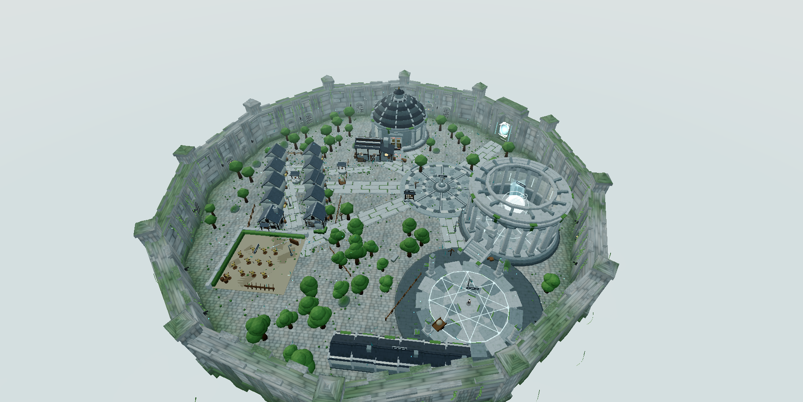

# Pick Me Up

A 3D browser gacha-and-action-RPG built with Three.js, based on the manhua
**Pick Me Up: Infinite Gacha**.

> **Status: in active development.** The hub and floors 1–2 are built out, and the
> floor 5 boss fight works. Floors 3+ reuse a placeholder art generator, and **three
> of the four standalone walk/layout test scripts currently fail**. Read
> [Known limitations](#known-limitations) before describing or demoing this build.



*Niflheimr — the hub town, a 12-sided walled island. Summon heroes, train and
forge them, then send a party of up to 5 into the Tower.*

---

## The two modes

**Hub — Niflheimr.** You are the Master. Summon heroes with Gems and Summon
Tickets, level them up at the Training Grounds, promote and synthesise them,
forge their gear at the Blacksmith, and pick a party. Iselle, the winged fairy
administrator, complains about all of it.

**Tower.** You play as Han Islat in third person, fighting alongside a squad of
AI companions you command in real time.

**Permadeath is real.** A hero that reaches 0 HP is deleted from the save. There
is no revival, and no undo.

Full design notes: [`docs/GDD.md`](docs/GDD.md) and [`docs/LORE.md`](docs/LORE.md).

---

## Quick start

```bash
npm install
npm run dev
```

Then open **http://localhost:5173**.

Requires **Node 20.19+ or 22.12+** — that comes from Vite 8. The floor is now
declared in `package.json` (`engines`) and pinned in `.nvmrc` (22.14.0, the
verified-working version).

### Scripts

| Command | What it does |
|---|---|
| `npm run dev` | Vite dev server with hot reload (port 5173) |
| `npm run build` | Production bundle into `dist/` (relative `base`, so it is portable) |
| `npm run preview` | Serve the built `dist/` locally |
| `npm test` | The green suite: the codemap integrity check + 11 phase suites |
| `npm run test:<name>` | One suite on its own — see [Testing](#testing) |

---

## Controls

### Gameplay

| Key | Action |
|---|---|
| `W` `A` `S` `D` | Move |
| **Left click** | Attack — 3-hit combo |
| **Right click** (hold) | Block / guard |
| `F` | Shield bash while blocking, otherwise attack |
| `Q` / `Space` | Roll / evade (`Q` drinks a mana potion instead in the spell loadout) |
| `E` | Interact — pick up an item, talk, use a facility |
| `C` (hold) | Open the squad command wheel, then `1`–`6` to pick an order |
| `V` / `C` | Bow aim (over-the-shoulder camera) |
| `X` | Toggle auto-combat |
| `Shift` | Sprint |

**Attack is Left click and block is Right click by default**; this is swappable
in Options → Combat Controls. Mouse buttons do **not** attack in the Hub.

In the spell loadout, `1`–`6` and `R` cast spells instead of issuing squad
orders. `Numpad1`–`Numpad6` always issue squad orders.

Squad orders on the command wheel, from `src/combat/Commands.js`:

| Key | Order |
|---|---|
| `1` | Follow |
| `2` | Hold Position |
| `3` | Attack Target |
| `4` | Fall Back |
| `5` | Focus Boss |
| `6` | Loose Arrows |

### Camera

| Key | Action |
|---|---|
| Arrow keys | Orbit and pitch (manual) |
| Mouse wheel | Zoom |

The camera is mouse-driven: click the canvas to capture the pointer, `Esc`
releases it. `W`/`A`/`S`/`D` only translate the character along camera-relative
axes — they never rotate the camera.

Options exposes graphics quality (Low/Medium/High), resolution scale
(50/75/100 %), an FPS-counter switch, follow speed (Tight/Normal/Loose), camera
distance (Near/Normal/Far), master volume, and the attack/block button swap.

### Interface

| Key | Action |
|---|---|
| `R` | Hero Roster (Hub only) |
| `T` | Deploy / enter the Tower (Hub only) |
| `O` | Options window (Hub only) |
| `Esc` | Close the Summon, Blacksmith and Equipment windows, and release the mouse pointer |
| `M` | Mute audio |
| `` ` `` | Toggle the FPS counter |
| `?` | Toggle the control hints |

`Esc` closes only those three windows — the Roster, Deploy, Options, Synthesis,
Training, Dormitory and Dungeon Board windows have no `Esc` handler, only their
✕ button.

---

## Architecture

Vanilla ES modules — no framework, no build-time codegen, one system per file.

| Directory | Purpose |
|---|---|
| `src/main.js` | Entry point: renderer, scene registration, RAF loop |
| `src/core/` | Engine services — input, scene switching, game state, inventory, stats, RNG, audio, emotions and training |
| `src/player/` | Third-person avatar and camera rig |
| `src/scenes/` | `HubScene.js` (Niflheimr) and `TowerScene.js` (raid combat) |
| `src/world/` | Dungeon generation, room graphs, floor layouts, environment props |
| `src/art/` | Procedural model factory — heroes, weapons, enemies, Iselle |
| `src/art/floors/` | Procedural floor biome mesh builders (farm, prairie, forest) |
| `src/art/town/` | Niflheimr town architecture, landmarks, terrain, walkability heightmap, collision |
| `src/combat/` | Hit resolution, enemies, AI brains, boss, telegraph, projectiles, spell system, command definitions |
| `src/ui/` | DOM HUD and every system window (Summon, Roster, Deploy, Synthesis, Blacksmith, …) |
| `src/gacha/` | Summon rates, draws, cinematic summon effect |
| `src/hub/` | Hub-specific logic — Iselle NPC, town NavGrid, hero NPCs, training, sparring, synthesis effect |
| `src/data/` | Pure data and formulas — heroes, enemies, items, skills, missions, `rules.js`, emotion & training configs |
| `src/fx/` | Slash trails, weapon FX, arrival dome |
| `src/dev/` | Unified Dev Lab (`dev.html`) — arena, cheats, storage, stats, weapon and spell tabs |
| `src/debug/` | Ground & rig diagnostic overlay |

Progress is saved to `localStorage` under `pickmeup_save_v1`.

---

## The procedural art system

This is the defining constraint of the project, and it is strict:

- **Primitives only.** No external 3D models and no external textures — not
  `.gltf`, not `.png`. Every mesh is built from `THREE.*` geometry at runtime.
- **Textures are generated in code** on a `<canvas>` and wrapped in a
  `CanvasTexture`.
- **Determinism comes from a seeded PRNG** (Mulberry32), so a given floor seed
  always regenerates the same layout. `src/world/floorLayouts.js` is the single
  source of truth for floor layouts.
- **Draw-call budgets** are declared per quality tier in
  `src/art/floors/FloorAssembler.js`:

  | Quality | Triangle budget | Draw-call budget |
  |---|---|---|
  | High | 240,000 | 48 |
  | Medium | 156,000 | 40 |
  | Low | 96,000 | 34 |

- **Floor art dispatch:** floor 1 → `farm.js`, floor 2 → `prairie.js`, floors 3+
  → `forest.js`.

The town and floor art modules are written against a contract rather than being
hand-modelled. See [`docs/ART_CONTRACT.md`](docs/ART_CONTRACT.md).

---

## Testing

There is no test runner, no linter, and no formatter configured. Verification is
a set of standalone Node scripts run directly. `npm install` must have run first.

### The green suite — `npm test`

```bash
npm test
```

`npm test` runs the codemap integrity check followed by 11 phase suites:

| Script | What it checks |
|---|---|
| `scripts/check_codemap.mjs` | `docs/CODEMAP.md` matches the files and exports on disk |
| `scripts/test_phase1_migration.mjs` | Emotion data model, star multiplier, squad leader, old-save migration |
| `scripts/test_phase2_emotions.mjs` | Emotion mutations, panic, decision weights, leader orders, lobby laws |
| `scripts/test_phase3_training_30days.mjs` | Training sessions, skill combining, Pain Tolerance, hit zones, sparring, the 30-day benchmark |
| `scripts/test_phase4_login_report.mjs` | Offline day calculation, report sorting, idle listing, dead-hero gear drop |
| `scripts/test_phase5_town_training.mjs` | Training sub-zones, live sparring, lobby laws, leader intervention, fast healing |
| `scripts/test_phase6_ui_and_integration.mjs` | Roster display model, save/reload roundtrip, full integration |
| `scripts/test_phase7_fight_ai.mjs` | Pure Fight AI — weights, panic, weapon styles, hysteresis, switch target |
| `scripts/test_phase8_emotion_fights.mjs` | Anger and fear+hunger fight triggers, the pairing algorithm, leader intervention |
| `scripts/test_phase9_consequences_and_report.mjs` | Fight consequences, relationship deltas, the login report fights summary |
| `scripts/test_phase10_training_xp_merge.mjs` | The merged training XP path and its save migration |
| `scripts/test_phase11_bugfixes.mjs` | The eleven Phase-11 bug fixes |

All of them pass, headless, with no display and no GPU.

`scripts/` also holds the combat-engine suites (`test_spells.mjs`,
`test_integration.mjs`, `test_loadout.mjs`), the camera-collision check
(`test_camera_collision.mjs`) and a set of Playwright-driven visual QA suites.
Each is runnable on its own, e.g. `npm run test:spells`.

### The standalone walk/layout scripts

These four live at the repo root, are **not** part of `npm test`, and cover the
town geometry and the hero rig:

```bash
npm run test:layouts        # node test-floor-layouts.mjs
npm run test:rig           # node test-rig-locomotion.mjs
npm run test:walkheight    # node test-walkheight.mjs
npm run test:walkbuildings # node test-walk-buildings.mjs
```

| Script | What it checks | Status |
|---|---|---|
| `test-floor-layouts.mjs` | Regression equality test — reproduces the original farm/forest layout math and asserts `generateFloorLayout()` still matches across 8 cases, plus walkability sampling | **FAILING** |
| `test-rig-locomotion.mjs` | Hero rig idle/walk/run: hip amplitude, step frequency, minimum foot sole height, foot correction clamp | Passing |
| `test-walkheight.mjs` | The cached `WalkHeightMap` against direct raycasts at 15 named town landmarks, 0.08 m tolerance | **FAILING** |
| `test-walk-buildings.mjs` | Door-to-interior walk height for all 8 buildings, step-jump limits, and the `UndergroundGuard` snap-back | **FAILING** |

The two walk-height scripts stub a 2D canvas context, so **all four run headless
with no display and no GPU.**

### Current failures

All three failures are pre-existing on the working tree, not caused by recent
changes:

- **`test-floor-layouts.mjs`** — aborts at floor 2 (seed 15851) with
  `exitPosition.x: 0 !== 5.110209415666759`. The test's inline reference
  implementation predates the floor 2 prairie layout, so its expected value is
  stale.
- **`test-walkheight.mjs`** — 10 of 15 landmarks pass. The five failures are the
  Summoning stair middle (0.715 m), the Summoning stair top (0.545 m), Town
  Square centre (0.525 m), the point next to the wall (0.241 m) and the Mess Hall
  door approach (0.893 m, the worst) against a 0.08 m tolerance. Several of those
  landmark *coordinates* are themselves stale — "Armory door approach" is sampled
  at (25, −12) and "Space-Time Rift" at (0, 40), neither of which matches the
  town any more — so the test and the town have drifted apart.
- **`test-walk-buildings.mjs`** — the Armory fails its max-difference and
  step-jump checks (0.610 m, 83 failing samples); Cottage 1, the Mess Hall and the
  Synthesis Chamber each fail the step-jump limit. The `UndergroundGuard` snap-back
  check passes.

Fixing these is the obvious next task; none has been diagnosed yet.

---

## Art viewer harness

Eight standalone pages for iterating on modules in isolation. They are served by
the dev server only — start `npm run dev`, then visit:

| Page | Module |
|---|---|
| `http://localhost:5173/art-test.html` | Hero — presets, poses, armor |
| `http://localhost:5173/art-enemy-test.html` | Enemies |
| `http://localhost:5173/art-weapon-test.html` | Weapons |
| `http://localhost:5173/art-iselle-test.html` | Iselle |
| `http://localhost:5173/art-town-test.html` | Niflheimr town |
| `http://localhost:5173/art-floor-test.html` | Floor art |
| `http://localhost:5173/dev.html` | Unified Dev Lab — combat balancing, weapons, spells, stats |
| `http://localhost:5173/combat-test.html` | Isolated combat sandbox |

---

## Developer shortcuts

All of these are bound in the scene and UI files, **not** in `src/core/Input.js`.

> ⚠️ **`F3` is gated.** The diagnostics panel only opens when the page URL carries
> `?debug=1` — e.g. `http://localhost:5173/?debug=1`. Without it, `F3` does
> nothing.

> ⚠️ **The Hub's `F1`/`F3`/`F6`/`F7`/`F12` handlers sit above the
> scene-activation guard**, so they also fire while the Tower is the active
> scene. `F1` in the Tower therefore wipes the save.

### Progress

| Key | Where | Action |
|---|---|---|
| `F1` | Hub | **Hard reset** — wipes `pickmeup_save_v1` from `localStorage` and reloads. Destroys all progress. |
| `F2` | Tower | Prompt for a floor number (1–100), jumps there and marks the tutorial done |
| `F2` | Hub | Sets the floor number and marks the tutorial done — it does **not** enter the Tower |
| `[` / `]` | Tower | Previous / next floor (1–5) |
| `H` | Tower | Return to the Hub |
| `Shift+G` | Tower | Force the exit gate open |

### Resources

| Key | Where | Action |
|---|---|---|
| `F9` | Hub | +1,000 Gems |
| `F10` | Hub | +50,000 Gold |
| `F11` | Hub | +1 Awakening Stone |
| `P` | Tower | Pin the boss weapon for 1.8 s (must be within 6 m) |
| `B` | Tower | Equip the Hunting Recurve Bow |

### Debug

| Key | Where | Action |
|---|---|---|
| `F3` | Both | Diagnostics panel — draw calls, triangles, FPS, light pool, per-module mesh counts. Requires `?debug=1`. |
| `F4` | Tower | Break the equipped weapon |
| `F5` | Tower | Kill all enemies |
| `F6` | Tower | Spawn a leader enemy |
| `F7` | Tower | Teleport to the boss arena |
| `F8` | Tower | Set boss HP to 55% |
| `F6` | Hub | Toggle the NavGrid collision debug mesh and collider wireframes; logs the stuck-hero count |
| `F7` | Hub | Hero audit — per-NPC rig, foot height vs. walk height, pose, opacity; flags anomalies in the console |
| `F12` | Hub | Toggle the WalkHeight debug point cloud (8 m radius around the player at 0.5 m spacing) |
| `\` | Both | Ground & rig diagnostic overlay in the Hub, tower debug overlay in the Tower |
| `Shift+\` | Hub | Record 5 s of telemetry into a markdown table and copy it to the clipboard |
| `Shift+F` | Tower | Hide/show the floor art group |
| `[` / `]` | Hub | Step time of day back/forward by 0.05 |
| `Shift+[` / `Shift+]` | Hub | Pause/resume the day cycle; jump to the next keyframe |
| `Insert` / `Shift+Insert` | Tower | Cycle Iselle's pose / expression — only while the `F3` panel is open. It drives whichever Iselle rig is registered on `window.__iselleRig`. |

> **Hub `F12` conflict.** `F12` is the WalkHeight debug cloud in the Hub, so the
> Hub's "+20 to all basic materials" cheat has no free key and stays unreachable.
> `F9`, `F10` and `F11` all work.

> The Hub minimap is **not** part of the `F3` panel — it is a permanent 150 px
> circle in the top-right corner, rendered every frame.

---

## Documentation

### Required reading

| File | Contents |
|---|---|
| [`AGENTS.md`](AGENTS.md) | The house rules for agents and contributors working in this repo |
| [`docs/CODEMAP.md`](docs/CODEMAP.md) | The file index, the "where do I look for…" lookup table and the gotcha log |
| [`docs/GDD.md`](docs/GDD.md) | Game design document — concept, rules and formulas, controls, camera system |
| [`docs/LORE.md`](docs/LORE.md) | Premise, world, core cast, Tower rules |

### Engineering reference

| File | Contents |
|---|---|
| [`docs/FLOOR_LAYOUT.md`](docs/FLOOR_LAYOUT.md) | Dumped reference for `src/world/floorLayouts.js` |
| [`docs/TOWN_LAYOUT.md`](docs/TOWN_LAYOUT.md) | Dumped reference for `src/art/town/layout.js` |
| [`docs/ART_CONTRACT.md`](docs/ART_CONTRACT.md) | The contract every art module is written against |

### Archive

[`docs/archive/`](docs/archive/README.md) holds the one-time audit, QA and
implementation reports. They are historical records of a specific task, **not**
kept in sync with the code — read them for context, not for current behaviour.

### Work ledger

[`TASKS.md`](TASKS.md) tracks everything. Gameplay tasks are `T###`, art plan
tasks are `A##`, and the combat-engine phases are `C##`. All gameplay tasks are
complete; the open items are `A02` (orc enemy models), `A06b` (forest floor art)
and `A06d` (floor iteration).

---

## Contributing

The house rules live in [`AGENTS.md`](AGENTS.md) (`GEMINI.md` is a one-line
pointer to it):

- **Stack:** Vite + vanilla JS + Three.js only. No other libraries unless asked.
- **Assets:** primitives only — no external 3D models or textures.
- **Architecture:** one system per file, organised under `src/`.
- **Workflow:** after every task that adds, removes, renames or moves a file,
  export or mapped function, update `docs/CODEMAP.md` and run
  `node scripts/check_codemap.mjs` — a task is not complete until it prints
  `CODEMAP OK`.
- **Scope discipline:** never rewrite files you were not asked to touch.
- **Reporting:** end every task with a report of 15 lines maximum.

---

## Known limitations

Features that are described in the design docs but **are not implemented**. They
are listed here so they do not get described as features.

- **Tarot cards.** `TASKS.md` T025 lists them in the manhua systems pass. There
  are zero references to tarot anywhere in `src/`.
- **Orc enemy models.** `src/data/enemies.js` ships goblins, the prairie wolf, the
  crystal slime, the mini slime and the rock crawler. Only the **orcs**
  (`orc_warrior`, `orc_archer`, `orc_berserker`, `orc_lord`) are still missing
  their models — see `TASKS.md` A02.
- **Milestone bosses.** `src/data/missions.js` returns `BOSS_BATTLE` for every
  floor where `floorNumber % 5 === 0`, but only **floor 5** actually spawns a
  boss. Floors 10, 15, 20 and so on advertise "DEFEAT THE BOSS!" and spawn
  nothing.
- **The floor 100 win condition.** The GDD states *"Win: clear 100 floors."* There
  is no victory sequence — it exists only as a UI string on the Dungeon Board.
- **Floors 3+ art.** `src/art/floors/forest.js` is a ~169-line stub: a ground
  plane, a road ribbon, clearing discs, two gates and pillar cylinders. Floors 6+
  reuse the same seeded forest generator with scaled grunts and no unique
  content.
- **Three failing test scripts** — see [Testing](#testing).

## Known debt

- **There is no LICENSE file and no `license` field.** `package.json` is
  `private: true`. Pick a licence before distributing.
- `docs/archive/ART_ISSUES.md` cites `/tmp/opencode/run-towerfloor.mjs` as
  evidence for floor smoke-testing. That harness lived outside the repo and no
  longer exists.
- `src/main.js` posts a screenshot to `/screenshot` 1.2 s after every load. The
  dev-server middleware writes it to `screenshot_hub.png` in the repo root, so
  that file churns on every `npm run dev`. It is now gitignored; the frozen copy
  lives under `docs/images/`.
- The working tree carries a large volume of uncommitted changes (140+ files),
  including the deleted `docs/ARGON.md` and
  `docs/ARGON_PROMPT_02_fight_ai.md` briefs and the orphaned `docs/ARGON_*` family.

---

## Acknowledgements

Based on the manhua **Pick Me Up: Infinite Gacha**. All art in this project is
generated procedurally at runtime from Three.js primitives — there are no
external assets.
